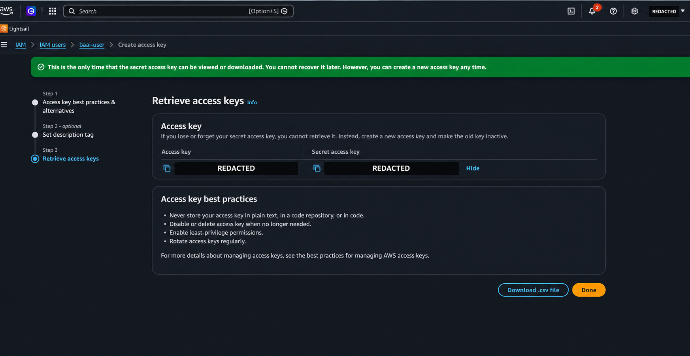
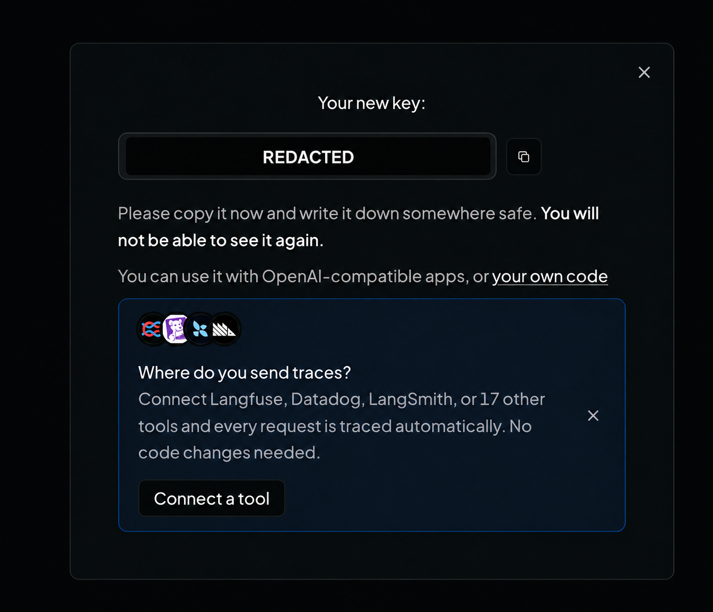
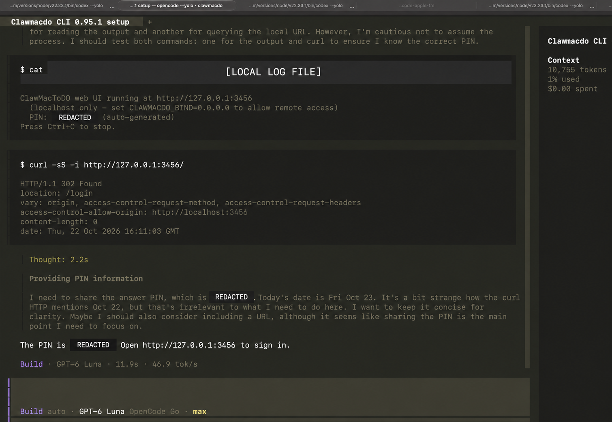

# Hermes Lab Workshop — Setup Guide

Prepare your AWS Lightsail credentials, OpenRouter API key, Telegram bot token, and Telegram user ID for the Building Autonomous AI Agents workshop. Then configure Hermes and test a conversation through Telegram.

The walkthrough follows the supplied images in [`screens/`](screens/), captured on 22–23 October 2026. Menu labels may change. Use your own account, bot name, and credentials when following the examples.

To host the ClawMacdo deployment UI, follow the [Railway deployment guide](railway/README.md). It installs `clawmacdo@0.95.1` and runs `clawmacdo serve --port 3456`.

## Before you begin

Have these ready:

- An AWS workshop account and a signed-in identity that can create IAM users, policies, and access keys. If your instructor provides a managed AWS account, use its assigned permissions.
- An [OpenRouter account](https://openrouter.ai/) with credits for the workshop's selected model.
- A Telegram account signed in on your phone or computer.
- A private password manager for the credentials you create.
- Terminal access to the computer or Lightsail server where you will run Hermes.
- Node.js with npm installed on your computer. Check with `node --version` and `npm --version`.
- The OpenCode terminal app installed and available through the `opencode` command. Follow [section 6.1](#61-install-opencode) if you need to install Node.js or OpenCode.

At the end of setup, you should have these five values:

| Value | Where it comes from | Where you use it |
| --- | --- | --- |
| AWS access key ID | IAM user → Security credentials | AWS CLI or the workshop's Lightsail deployment tool |
| AWS secret access key | Same access-key creation screen | Together with the AWS access key ID |
| `OPENROUTER_API_KEY` | OpenRouter → API Keys | Hermes model configuration |
| `TELEGRAM_BOT_TOKEN` | Telegram → BotFather | Hermes Telegram gateway |
| Your numeric Telegram user ID | Telegram → `@userinfobot` | Hermes `TELEGRAM_ALLOWED_USERS` |

Keep the actual keys and tokens out of this README, source code, screenshots, and chat messages. The AWS credentials manage infrastructure; OpenRouter and Telegram credentials connect the running agent to those services.

> **Screenshot privacy:** The AWS key-pair and OpenRouter key images below are edited copies with credential fields redacted. Their original captures remain local and are excluded from Git. The original AWS capture exposed a complete key pair; rotate that key even though the guide now uses a redacted copy.

## 1. Create an AWS IAM user

### 1.1 Open IAM and create the workshop user

1. Sign in to the [AWS Management Console](https://console.aws.amazon.com/).
2. Search for **IAM** in the top search bar and open **Identity and Access Management**.
3. Select **Users** or **IAM users**, then **Create user**.
4. Enter a user name such as `baai-user`. Use a distinct name if you share an account with other participants.
5. Leave **Provide user access to the AWS Management Console** unchecked. This lab user will use programmatic credentials; your existing administrator session performs the setup.
6. Continue through **Set permissions** without attaching a policy yet, matching the screenshots.
7. Review the details and select **Create user**. Add the Lightsail permission in the next section.

This follows the [AWS IAM user creation workflow](https://docs.aws.amazon.com/IAM/latest/UserGuide/id_users_create.html).

<details>
<summary>View screenshots: find IAM and create the user</summary>


</details>

### 1.2 Attach the Lightsail policy

The screenshots use **`LightsailFullAccess`**, labelled **Customer managed**. This is a policy created in that AWS account, so it may not appear in yours.

If your instructor has already provided this policy, attach it:

1. Open **IAM → Users → baai-user → Permissions**.
2. Select **Add permissions → Add permissions**.
3. Choose **Attach policies directly**.
4. Search for `LightsailFullAccess` and select its checkbox.
5. Select **Next**, review, then **Add permissions**.
6. Confirm the policy appears under **Permissions policies**.

If the policy is missing, an IAM administrator can create it for the workshop:

1. Open **IAM → Policies → Create policy**.
2. Switch the policy editor to **JSON** and enter the following example.
3. Select **Next**, name the policy `LightsailFullAccess`, and create it.
4. Return to the user and attach it using the steps above.

```json
{
  "Version": "2012-10-17",
  "Statement": [
    {
      "Sid": "WorkshopLightsailAccess",
      "Effect": "Allow",
      "Action": "lightsail:*",
      "Resource": "*"
    }
  ]
}
```

This example grants all Lightsail actions, including creating and deleting resources, across the account. Use it in a dedicated workshop account; use your instructor's scoped policy when one is provided. The screenshots show the policy name, not its JSON; the example above follows [AWS's documented Lightsail policy](https://docs.aws.amazon.com/lightsail/latest/userguide/security_iam_id-based-policy-examples.html).

<details>
<summary>View screenshots: attach and verify Lightsail permissions</summary>


</details>

## 2. Generate the AWS access key and secret access key

1. Open **IAM → Users → baai-user → Security credentials**.
2. Find **Access keys** and select **Create access key**. Use this section rather than the separate **API keys** section shown below it.
3. Choose the use case matching where the credentials will run. For a local AWS CLI, choose **Command Line Interface (CLI)**. The supplied screenshot selects **Application running on an AWS compute service**.
4. Read the alternatives, acknowledge the confirmation if shown, and select **Next**.
5. Add a description such as `Hermes workshop Lightsail deployment`.
6. Select **Create access key**.
7. Copy both the **Access key ID** and **Secret access key** into your password manager. You can also download the CSV to a private location outside the project.
8. Select **Done** after saving both values.

The secret is shown only at creation. If you lose it, create a replacement and deactivate the old key. Create credentials for the workshop IAM user; do not create root-user access keys. See [AWS access-key management](https://docs.aws.amazon.com/IAM/latest/UserGuide/access-keys-admin-managed.html).

<details>
<summary>View screenshots: access-key creation</summary>




</details>

### Verify the AWS credentials

On the machine that will manage Lightsail, install [AWS CLI v2](https://docs.aws.amazon.com/cli/latest/userguide/getting-started-install.html) if needed. Then create a separate workshop profile:

```bash
aws --version
aws configure --profile hermes-workshop
```

Enter your own values at the prompts:

```text
AWS Access Key ID: <YOUR_AWS_ACCESS_KEY_ID>
AWS Secret Access Key: <YOUR_AWS_SECRET_ACCESS_KEY>
Default region name: ap-southeast-1
Default output format: json
```

Use the region assigned for your lab; `ap-southeast-1` is the Singapore example. The CLI stores the profile under `~/.aws/`, outside this repository. See [AWS named-profile configuration](https://docs.aws.amazon.com/cli/latest/userguide/cli-configure-files.html).

Check the authenticated identity and Lightsail read access:

```bash
aws sts get-caller-identity --profile hermes-workshop --no-cli-pager
aws lightsail get-instances --profile hermes-workshop --region ap-southeast-1 --no-cli-pager
```

The first command should identify your workshop user. The second should return an instance list; an empty `instances` list is valid for a new account. These checks do not create resources. A successful identity check alone does not prove that Lightsail permissions are attached. See the [Lightsail get-instances reference](https://docs.aws.amazon.com/cli/latest/reference/lightsail/get-instances.html).

## 3. Generate an OpenRouter API key

1. Sign in to [OpenRouter](https://openrouter.ai/).
2. Select the account and workspace you will use for the lab.
3. Open **API Keys** in the sidebar, or go to the [API keys page](https://openrouter.ai/settings/keys).
4. Select **+ New Key** or **Create Key**.
5. Use a descriptive name such as `hermes-workshop`.
6. Set an expiration that covers the workshop. The screenshot uses **7 days**.
7. Set a **Credit limit**, for example **USD 5**, and leave the reset at **N/A** for a total limit, matching the screenshot. This is an example spending cap, not a guaranteed workshop cost.
8. Select **Create**, then copy the full key into your password manager as `OPENROUTER_API_KEY`.

Copy the key before closing the dialog; the full value is only revealed at creation. A key limit does not add funds: check your [account credits](https://openrouter.ai/settings/credits) before using a paid model. OpenRouter documents key expiration and spending limits in its [API key reference](https://openrouter.ai/docs/api/api-reference/api-keys/create-keys).

<details>
<summary>View screenshots: create and save the OpenRouter key</summary>




</details>

## 4. Create a Telegram bot and obtain its token

### 4.1 Find BotFather

1. Open Telegram and search for **`@BotFather`**.
2. Select Telegram's official, verified BotFather account. You can open it directly at [t.me/BotFather](https://t.me/BotFather).
3. Select **Start**, or send `/start`.


### 4.2 Create your bot

The screenshots show the BotFather mini app:

1. Send `/mybots` and open the bot-management panel if prompted.
2. Select **Create a New Bot**.
3. Enter a display name, for example `Hermes Workshop Assistant`.
4. Enter a unique username ending in `bot`, for example `baai_yourname_2026_bot`. Choose another username if it is taken.
5. Leave **About** optional, or enter a short workshop description.
6. Select **CREATE BOT**.

Alternatively, send `/newbot` in the BotFather chat and answer its prompts for a display name and username. Both flows create the bot and provide its token. See [Telegram's BotFather instructions](https://core.telegram.org/bots/features#botfather).

<details>
<summary>View screenshots: create a bot using the BotFather panel</summary>


</details>

### 4.3 Copy the bot token

1. Open your new bot's settings in BotFather.
2. Select **Copy** next to the token. In the chat-based flow, copy the HTTP API token from BotFather's reply.
3. Save the complete value as `TELEGRAM_BOT_TOKEN` in your password manager.
4. Open your new bot using its `t.me` link and select **Start**. It will respond after Hermes is connected and its gateway is running.

The token contains a numeric prefix, a colon, and a secret string. Copy the entire token. The numeric prefix identifies the bot; it is not your personal Telegram user ID.


## 5. Retrieve your Telegram user ID

1. In Telegram, search for **`@userinfobot`**, or open [t.me/userinfobot](https://t.me/userinfobot).
2. The screenshots show the display name **User Info · Get ID · IDbot**.
3. Select **Start**, or send `/start`.
4. Find the numeric value beside **Id** in its reply.
5. Save your own number for the Hermes **allowed user IDs** setting.

For example, if the reply says `Id: 123456789`, your setting will be:

```dotenv
TELEGRAM_ALLOWED_USERS=123456789
```

Replace the example number with yours. Use the numeric ID rather than your `@username`, phone number, bot token prefix, or a group chat ID. `@userinfobot` is a third-party lookup bot; it does not need your bot token or any API keys. This lookup method is also described in the [Hermes Telegram guide](https://hermes-agent.nousresearch.com/docs/user-guide/messaging/telegram#step-4-find-your-user-id).


## 6. Install OpenCode and start the ClawMacdo web UI

Use OpenCode to install ClawMacdo and start its local deployment UI. This walkthrough follows the screenshots in [`screens/opencode/`](screens/opencode/). Run these steps on the computer where you will open the browser.

### 6.1 Install OpenCode

Use a macOS, Linux, or WSL terminal with Node.js and npm installed. If needed, install Node.js from the [official download page](https://nodejs.org/en/download), then open a new terminal. Check the prerequisites:

```bash
node --version
npm --version
```

Install the current OpenCode V2 CLI using the command in the [official installation guide](https://opencode.ai/v2/docs):

```bash
npm install -g @opencode/cli
opencode --version
```

Open a terminal in this workshop's repository folder and launch OpenCode:

```bash
opencode
```

### 6.2 Connect a model provider

In OpenCode, enter `/connect`, choose **OpenRouter**, and paste the API key you created in section 3 into the credential prompt. Then enter `/models` and select the instructor's model with tool support. The [OpenCode provider guide](https://opencode.ai/v2/docs/providers) describes these commands.

The screenshots use an already-connected **OpenCode Go** account. You can use your connected OpenRouter account for this exercise. Configuring OpenRouter in Hermes does not automatically configure it in OpenCode.

### 6.3 Ask OpenCode to install and serve ClawMacdo

Use the **Build** agent, shown at the bottom of the screenshots, so OpenCode can carry out the installation. See [OpenCode's built-in agents](https://opencode.ai/v2/docs/agents#builtins).

Enter this prompt:

```text
Install the clawmacdo CLI using this command npm install -g clawmacdo@0.95.1 then start the web UI locally
```


Review any command permission prompts. The screenshots show OpenCode installing version `0.95.1`, checking the CLI, and starting this command in the background:

```bash
CLAWMACDO_BIND=127.0.0.1 clawmacdo serve --port 3456
```

The local URL is **http://127.0.0.1:3456**. Wait for the startup message before opening it.


### 6.4 Retrieve the PIN and sign in

ClawMacdo prints its login PIN in the server's startup output. If OpenCode started the server in the background, ask in the same session:

```text
What is the PIN? Read the startup output of the ClawMacdo server you started.
```


OpenCode can read the background process's log and report the PIN. The screenshot also shows an HTTP `302` redirect to `/login`, confirming that the web server is responding.



Open **http://127.0.0.1:3456** in your browser and enter the PIN from **your own running server**. All PIN occurrences and the private log-file path in the published screenshot are redacted; the original capture is excluded from Git.

To choose your own six-digit PIN, set **`CLAWMACDO_PIN`** in the server's environment before starting it. Restart an existing server after changing that variable. For Railway, set it under the service's **Variables** and redeploy; see the [Railway guide](railway/README.md).

### 6.5 Start it directly from a terminal

You can also perform the same installation and startup yourself:

```bash
npm install -g clawmacdo@0.95.1
clawmacdo --version
CLAWMACDO_BIND=127.0.0.1 clawmacdo serve --port 3456
```

Keep this terminal open, read the PIN from its output, and open **http://127.0.0.1:3456**. Press `Ctrl+C` in this terminal to stop the server. If OpenCode already started a background server, ask it to stop that process before running another copy on port `3456`.

| Problem | What to check |
| --- | --- |
| `npm` is not found | Install Node.js and reopen the terminal. |
| `opencode` or `clawmacdo` is not found after installation | Reopen the terminal and check that your npm global executable directory is on `PATH`. |
| OpenCode cannot call the model | Check `/connect`, the selected model in `/models`, and your provider's credits. |
| Port `3456` is already in use | Use the existing server or stop it before starting another. |
| The browser cannot connect | Confirm the server is still running and the browser is on the same computer. |
| The PIN is rejected | Read the current server's startup output or check its `CLAWMACDO_PIN` environment setting. |

## 7. Connect the credentials to Hermes

Run this section on the machine that will host Hermes. For the AWS lab, connect to the Lightsail server provided or created during the deployment exercise. For a local exercise, use your own terminal.

### 7.1 Install Hermes if needed

For a Linux server, macOS, or WSL2 terminal with the prerequisites listed in the [Hermes installation guide](https://hermes-agent.nousresearch.com/docs/getting-started/installation):

```bash
curl -fsSL https://hermes-agent.nousresearch.com/install.sh | bash
```

Open a new terminal or reconnect your SSH session after installation, then check the command:

```bash
hermes --help
```

Skip installation if the workshop server already has Hermes. Use the same operating-system user for configuration and for running the gateway.

### 7.2 Configure OpenRouter

Run the model setup wizard:

```bash
hermes model
```

Choose **OpenRouter**, enter your saved API key when prompted, and select the model assigned by your instructor. Then start a chat:

```bash
hermes
```

Ask `Reply with: Hermes model connection works.` Confirm a response before configuring Telegram. This is a model API call and uses your OpenRouter credits. The interactive provider workflow is documented in the [Hermes quickstart](https://hermes-agent.nousresearch.com/docs/getting-started/quickstart#2-choose-a-provider).

### 7.3 Configure Telegram

Exit the chat and run:

```bash
hermes gateway setup
```

Select **Telegram**, then enter your **bot token** and your **numeric user ID** in the allowed-user field. The wizard saves the configuration.

For a standard Linux/macOS/WSL installation using the default profile, the relevant entries in `~/.hermes/.env` are:

```dotenv
OPENROUTER_API_KEY=<YOUR_OPENROUTER_API_KEY>
TELEGRAM_BOT_TOKEN=<YOUR_TELEGRAM_BOT_TOKEN>
TELEGRAM_ALLOWED_USERS=<YOUR_NUMERIC_TELEGRAM_USER_ID>
```

These are placeholders. If editing manually, update the existing entries in that private file without overwriting unrelated configuration. The model selection is handled separately by `hermes model`. See [Hermes Telegram configuration](https://hermes-agent.nousresearch.com/docs/user-guide/messaging/telegram#step-5-configure-hermes).

### 7.4 Run and test the gateway

Start one gateway process:

```bash
hermes gateway
```

Open **your new bot's chat**, select **Start** if needed, and send:

```text
Hello Hermes. Reply with: Telegram connection works.
```

Confirm a reply in Telegram. Keep the terminal or SSH session open during this foreground test; press `Ctrl+C` to stop it. If your workshop deployment already runs the gateway as a service, restart that service after configuration instead of starting a second copy. See [starting the Telegram gateway](https://hermes-agent.nousresearch.com/docs/user-guide/messaging/telegram#start-the-gateway).

## 8. Ready for the lab and cleanup

Setup is complete when AWS identifies the correct user and lists Lightsail instances, Hermes answers a model test, and your Telegram bot replies to your allowed account.

The repository also includes the [Hermes compare-offers skill](examples/hermes/compare-offers/SKILL.md) and its [practice cases](examples/hermes/compare-offers/test-cases.json) for the workshop exercises.

When the lab finishes, stop the gateway and delete workshop cloud resources you no longer need using the deployment exercise's cleanup instructions. Deactivate and delete unused AWS access keys, revoke unused OpenRouter keys, and revoke the Telegram token in BotFather if retiring the bot. Keep any credentials you retain in your password manager and private configuration files.

## 9. Troubleshooting

| Problem | What to check |
| --- | --- |
| `LightsailFullAccess` is missing | It is a customer-managed policy in the screenshots. Create the example policy from section 1.2 or use the instructor-provided policy. |
| AWS says no permissions were selected | Tick the policy's checkbox, then continue to the review screen. |
| AWS `AccessDenied` for Lightsail | Confirm the policy is attached to the same IAM user used by the CLI profile. Account-level restrictions or permission boundaries can also deny access. |
| AWS credentials are invalid | Check that the access key and secret belong to the same active key pair and that you selected `hermes-workshop`. |
| AWS secret key was not saved | Generate a replacement; AWS cannot reveal the old secret again. |
| OpenRouter returns `401` | Re-enter the complete key through `hermes model`; check expiration and revocation. |
| OpenRouter reports insufficient credit or a key limit | Check both the account credit balance and the key's spending cap. |
| Telegram username is unavailable | Choose a unique bot username ending in `bot`. |
| Telegram bot does not respond | Check that the gateway is running, the token belongs to this bot, and your own numeric ID is allowed. Send the message to your bot rather than BotFather. |
| Telegram reports a polling conflict | Stop the duplicate gateway or other program using the same token. Use one running gateway for the workshop bot. |
| Telegram token was revoked | Copy the replacement token from BotFather, update the gateway configuration, and restart it. |

For further diagnosis, consult the [OpenRouter Hermes integration guide](https://openrouter.ai/blog/tutorials/hermes-agent/) and [Hermes Telegram troubleshooting](https://hermes-agent.nousresearch.com/docs/user-guide/messaging/telegram#troubleshooting).
